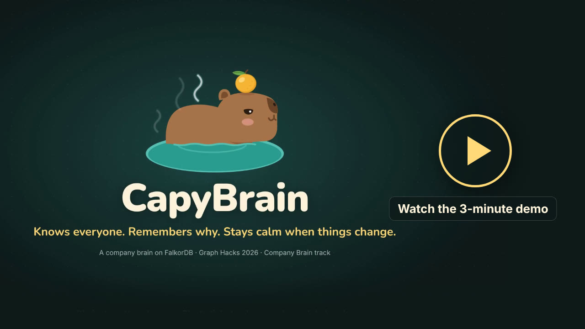
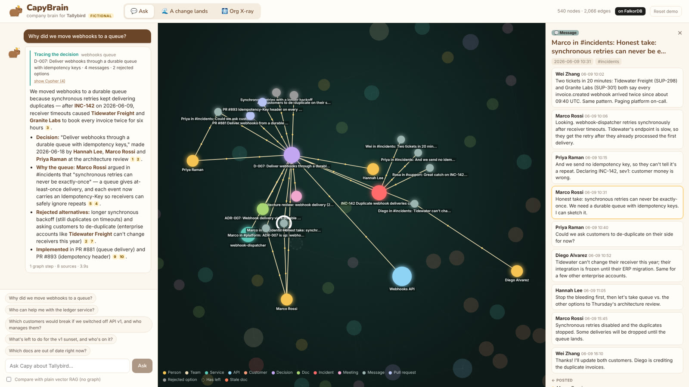
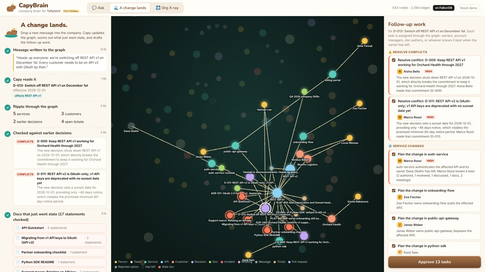
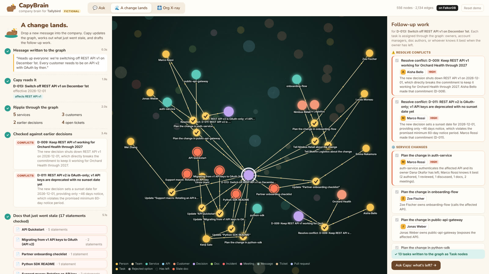
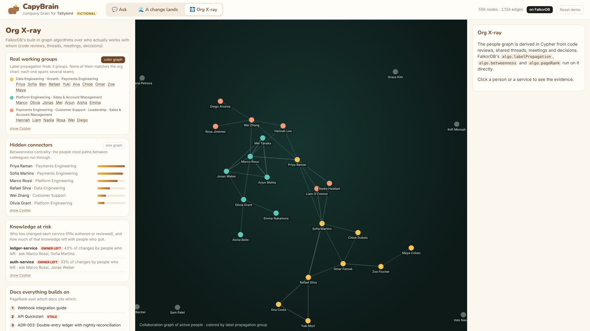
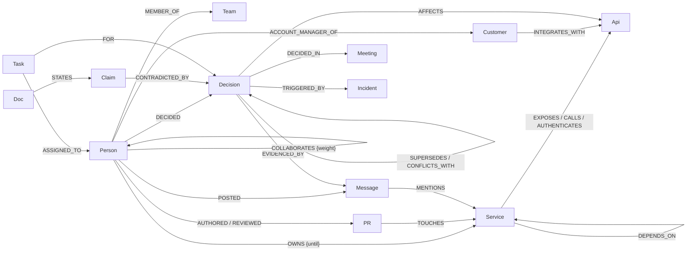
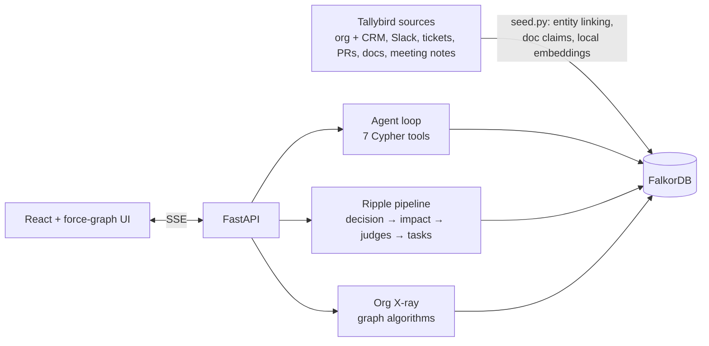

<p align="center">
  
</p>

<h1 align="center">CapyBrain</h1>

<p align="center"><b>A company brain on FalkorDB that keeps itself current and does the follow-up.</b><br/>
<i>Knows everyone. Remembers why. Stays calm when things change.</i></p>

<p align="center">
  <b>Track 03: Company Brain</b> · Graph Hacks 2026 (WeMakeDevs × FalkorDB)<br/>
  ▶️ <a href="https://www.youtube.com/watch?v=e1h5JVlbJRE"><b>Watch the 3-minute demo on YouTube</b></a>
</p>

[](https://www.youtube.com/watch?v=e1h5JVlbJRE)

## 1. What it is

CapyBrain turns everything a company knows into one FalkorDB knowledge graph: people, teams, services, APIs,
customers, decisions, docs, Slack threads, tickets and pull requests. Its agent, Capy, answers questions by
walking that graph, so every answer comes with the path it took and citations to the original message, doc or
meeting. When something changes (*"we're switching off API v1 on December 1st"*), CapyBrain writes the change into
the graph as a decision, finds every promise and doc it contradicts, and drafts the follow-up work, routing each
task to the right person through the ownership graph. The demo runs on **Tallybird**, a fictional 33-person
payments company; all of its data is synthetic and was written for this project.

## 2. The problem, and our solution

**The problem.** Company knowledge is scattered and it decays silently:
- Runbooks tell you to page people who left months ago.
- The reasons behind decisions are buried in threads nobody can find.
- When a plan changes, nobody knows which docs, customers and promises it just broke.

"Chat with your docs" can't fix this, because the facts that matter are **relationships**, not text: who owns
what, who has left, which customer integrates with which API, which decision affects which system. Vector search
over text chunks never sees them.

**Our solution.** Put the relationships first, and let an agent work on them.

| | What you do | What CapyBrain does |
|---|---|---|
| 💬 **Answers with a path** | Ask *"Why did we move webhooks to a queue?"* | Finds the decision, then walks to the incident that triggered it, the review meeting, who decided, the rejected options and the PRs that shipped it. The trail lights up on the graph and every claim is cited. |
| 👤 **Knows everyone** | Ask *"Who can help with the ledger service?"* | Knows its owner, Dana, has left. Ranks the people who actually know it by evidence (code reviews, answered questions, meetings): Marco, then Wei, a support engineer. |
| 🌊 **Stays current** | Drop in a new message: *"we're switching off REST API v1 on Dec 1"* | Creates a `Decision` node and follows the ripple to 5 services, 3 customers and 4 open tickets. Catches 2 conflicts (a promise Sales made to Orchard Health, and only 46 days' notice when 60 were promised) and marks 5 docs stale, with suggested rewrites. Takes about 6 seconds. |
| ✅ **Gets work done** | Review and approve | 13 follow-up tasks, each routed through the graph: doc fixes to their authors, customer notices to account managers, conflicts to whoever made the promise, and the auth-service work to the best active expert because its owner left. Approved tasks are written back, so *"what's left?"* has an answer tomorrow. |
| 🩻 **Org X-ray** | Open the X-ray | Graph algorithms show the real working groups (none match the org chart), the hidden connectors, and which knowledge left with people who quit. |

**Why not plain RAG?** The app includes a side-by-side mode that runs plain vector RAG over the same text with the
same model. Asked *"Which customers would break if we switched off API v1?"*, plain RAG finds one customer and says
it can't see a full list. CapyBrain finds all three, their account managers, and the promise to Orchard Health.

| Ask: every answer is a path, with sources | A change lands: conflicts, stale docs and routed follow-ups |
|---|---|
|  |  |
| **Approved tasks are written back to the graph** | **Org X-ray: real working groups and hidden connectors** |
|  |  |

## 3. How we use FalkorDB

FalkorDB is where every answer, every decision and every task lives. The graph does the retrieval, ownership,
impact analysis and task routing. The LLM picks which tool to call, reads new messages, judges conflicts and
contradictions, and writes the prose.

| FalkorDB feature | What it does in CapyBrain |
|---|---|
| **Multi-hop Cypher** (variable-length paths, pattern comprehensions) | The agent's 7 tools are named Cypher queries: decision trace, expertise ranking, impact up to 3 hops, open work. Each one also returns the subgraph it walked, which the UI animates. |
| **Vector index** (`db.idx.vector.queryNodes`) on 4 labels | Finds where to start (messages, docs, tickets, decisions), finds doc statements similar in meaning to a new decision, and powers agent memory (past `Answer` nodes). |
| **Full-text index** (`db.idx.fulltext.queryNodes`, fuzzy `%term%`) | Resolves names the user or model typed ("the ledger", "Orchard") to graph nodes. |
| **`algo.labelPropagation`, `algo.betweenness`, `algo.pageRank`** | Org X-ray: real working groups, hidden connectors, and the docs everything else cites. |
| **`GRAPH.COPY`** | Keeps a pristine seed graph. "Reset demo" is one copy, and the ablation test runs on a copy. |
| **`GRAPH.RO_QUERY`** | Lets the agent write its own Cypher for odd questions; the database itself refuses any write. |
| **Many graphs per instance** | Seed, live and test graphs side by side. |

**Proof that the graph isn't decoration.** [`tests/test_graph.py`](tests/test_graph.py) copies the graph, deletes
only the `INTEGRATES_WITH` relationships (every node and every word of text stays), and asks which customers break
if v1 goes away. The answer goes from 3 to 0.

### Graph data model

About 540 nodes and 2,100 relationships after seeding. The graph grows as changes land and tasks are approved.



- **Nodes:** `Person` (with `status: active/departed`), `Team`, `Service`, `Api`, `Customer`, `Decision`,
  `Alternative` (a rejected option), `Doc`, `Claim` (one statement from a doc; claims go stale individually),
  `Message`, `Channel`, `Ticket`, `PR`, `Meeting`, `Incident`, `Task` (follow-up work) and `Answer` (agent memory).
- **Indexes:** every node also has an `:Entity` label, with a range index on `id` and a full-text index on
  `name` and aliases. Nodes with text also have `:Searchable`, with a 384-dimension embedding in a cosine vector index.
- **Derived links:** `COLLABORATES` is built in Cypher from code reviews, shared threads, meetings and joint
  decisions.
- **Created at runtime:** `SUPERSEDES`, `UPDATES`, `CONFLICTS_WITH`, `CONTRADICTED_BY` and the `Task` links are
  written by the ripple pipeline.

### Cypher queries

All 29 queries the product runs are listed in **[docs/queries.md](docs/queries.md)**, generated from
[`capybrain/queries.py`](capybrain/queries.py). The first two below are trimmed; the third is complete.

```cypher
// Who knows X? Score every person by evidence in the graph. People who left are reported separately.
MATCH (x:Entity {id: $id}) MATCH (p:Person)
WITH x, p,
  size([(p)-[:AUTHORED]->(pr1:PR)-[:TOUCHES]->(x) | pr1]) AS authored,
  size([(p)-[:REVIEWED]->(pr2:PR)-[:TOUCHES]->(x) | pr2]) AS reviewed,
  size([(p)-[:POSTED]->(m1:Message)-[:MENTIONS]->(x) | m1]) AS discussed  // ...docs, meetings, tickets
RETURN p, 3.0*authored + 2.0*reviewed + 1.5*discussed AS score ORDER BY score DESC
```

```cypher
// What does a change to X touch? Services up to 3 hops away, each via its shortest path, with owners.
MATCH path = (s:Service)-[:EXPOSES|CALLS|AUTHENTICATES|DEPENDS_ON*1..3]->(x:Entity {id: $id})
WITH s, path ORDER BY length(path)
WITH s, collect(path)[0] AS shortest
OPTIONAL MATCH (owner:Person)-[o:OWNS]->(s)
RETURN s, length(shortest) AS hops, owner, o.until AS owner_until
```

```cypher
// Real working groups
CALL algo.labelPropagation({nodeLabels: ['Active'], relationshipTypes: ['COLLABORATES'], maxIterations: 20})
YIELD node, communityId
RETURN communityId, collect(node.name) AS members
```

### Architecture



The agent runs on Qwen3.8-27B through W&B Inference; any OpenAI-compatible endpoint that supports tool calling
works. Embeddings run locally (`BAAI/bge-small-en-v1.5`), so no second API key is needed.

## 4. Run it locally

You need **Docker** and an API key for an **OpenAI-compatible LLM endpoint with tool calling**. The default is
W&B Inference with `Qwen/Qwen3.8-27B`.

```bash
git clone https://github.com/chinesepowered/hack-falkor.git && cd hack-falkor
cp .env.example .env          # set LLM_API_KEY (and LLM_BASE_URL / LLM_MODEL for another provider)
docker compose up --build     # starts FalkorDB + CapyBrain; the first start seeds the graph (~30 s)
```

- **CapyBrain:** http://localhost:8000
- **FalkorDB Browser:** http://localhost:3000 (graph `tallybird`), if you want to explore the graph yourself

**A 2-minute tour:**
1. Ask *"Why did we move webhooks to a queue?"* and *"Who can help me with the ledger service?"*
2. Tick **Compare with plain vector RAG** and ask *"Which customers would break if we switched off API v1?"*
3. Open **A change lands**, then click **Drop it in the hot spring 🍊**.
4. Approve the tasks, then click **Ask Capy: what's left?**
5. Open **Org X-ray**.
6. **Reset demo** restores the seed graph.

<details>
<summary>Without Docker (development setup), tests and configuration</summary>

```bash
# FalkorDB: docker run -p 6379:6379 -p 3000:3000 falkordb/falkordb:latest
# (or with no Docker at all: pip install falkordblite and run its bundled redis-server with --loadmodule falkordb.so)
python -m venv .venv && . .venv/bin/activate && pip install -r requirements.txt
python -m capybrain.seed                        # builds tallybird_seed and copies it to tallybird
uvicorn capybrain.api:app --reload --port 8000
cd frontend && npm install && npm run dev       # http://localhost:5173 (proxies /api to :8000)

python -m pytest tests/ -q                      # 10 graph tests (no LLM needed) + 3 end-to-end LLM tests
```

| Variable | Default | |
|---|---|---|
| `LLM_BASE_URL` | `https://api.inference.wandb.ai/v1` | any OpenAI-compatible endpoint |
| `LLM_API_KEY` | (none) | required for Ask and A change lands |
| `LLM_MODEL` | `Qwen/Qwen3.8-27B` | must support tool calling |
| `LLM_NO_THINK` | `{"chat_template_kwargs": {"enable_thinking": false}}` | turns off reasoning for fast JSON calls; set to `{}` for providers without it |
| `FALKORDB_HOST` / `FALKORDB_PORT` / `FALKORDB_PASSWORD` | `localhost` / `6379` | `docker compose` sets these for you |

</details>

## More

- **[docs/explainer.md](docs/explainer.md):** how each part works and why, with answers to likely questions.
- **[docs/queries.md](docs/queries.md):** every Cypher query, with what it is for.
- **[data/tallybird/](data/tallybird):** the fictional company. It is shaped like real exports: org and CRM data,
  a Slack export, tickets, PRs, Markdown docs and meeting notes.
- **AI assistance (disclosed per the rules):** we built this with heavy help from an AI coding assistant (Claude
  Code), which wrote most of the code, the synthetic dataset and the docs under our direction. We chose the idea,
  theme and storylines, reviewed the design, and are responsible for the result. The video narration and music
  were generated with ElevenLabs.
- **License:** MIT. Capy the capybara is original artwork made for this project.
