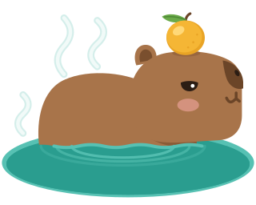
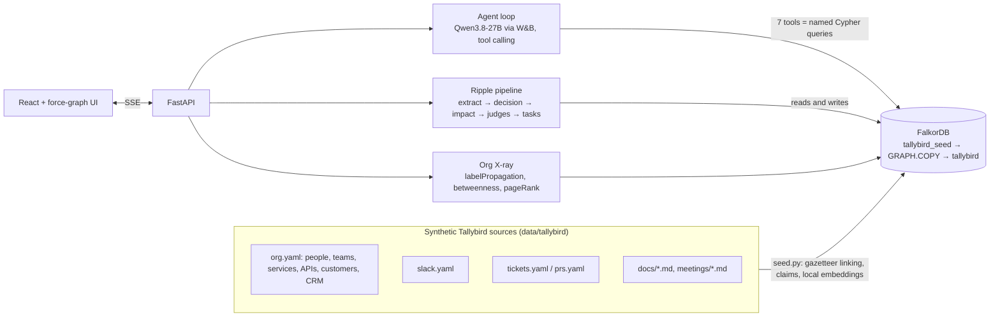
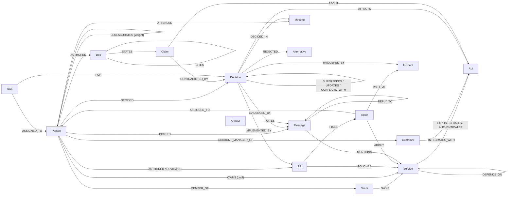

<p align="center">
  
</p>

<h1 align="center">CapyBrain</h1>

<p align="center"><b>A company brain on FalkorDB that keeps itself current and does the follow-up.</b><br/>
Knows everyone. Remembers why. Stays calm when things change.</p>

<p align="center">
  <b>Track:</b> Company Brain (Graph Hacks 2026, WeMakeDevs × FalkorDB) ·
  <a href="#demo-video">Demo video</a> ·
  <a href="#quick-start">Quick start</a> ·
  <a href="#graph-data-model">Graph model</a> ·
  <a href="docs/queries.md">Cypher catalog</a> ·
  <a href="docs/explainer.md">How it works</a>
</p>

---

Every company has a brain; it's just scattered across Slack, tickets, docs and people's heads. CapyBrain puts
people, teams, services, APIs, customers, decisions, docs, chat, tickets and pull requests into **one FalkorDB
graph**, and gives it an agent, **Capy**, that:

1. **Answers with a path.** Ask *why* something was decided or *who* knows something; Capy walks the graph and
   every claim cites the message, doc, meeting or ticket it came from. The trail lights up as she walks it.
2. **Stays current when a change lands.** Drop a new message ("we're switching off API v1 on Dec 1"): Capy
   writes it into the graph as a decision, follows the ripple to services, customers, owners and docs, catches
   conflicts with earlier decisions and promises, and marks contradicted doc statements as stale.
3. **Gets work done.** It drafts the follow-up (doc fixes, customer notices, service changes, conflicts to
   resolve) and routes each task through the ownership graph, including to whoever knows a system best when its
   owner has left. Approved tasks become part of the graph, so "what's left?" has an answer tomorrow.
4. **X-rays the org.** FalkorDB's built-in algorithms (label propagation, betweenness, PageRank) show the real
   working groups, the hidden connectors, and which knowledge left with people who quit.

The company in the demo, **Tallybird**, is fictional: every person, customer, message and document is synthetic
and was written for this project.

## Demo video

▶️ **[Watch the 3-minute demo](demo/capybrain-demo.mp4)** (narrated; LLM wait times are shortened and marked with a fast-forward badge).

| Ask: every answer is a path | A change lands: the ripple | Follow-up work, routed through the graph | Org X-ray |
|---|---|---|---|
|  |  |  |  |

## What makes the graph essential

- **Answers are traversals.** The vector index only finds a starting point; ownership, "who has left", customer
  integrations, decision lineage, conflicts and staleness are all relationships. The agent's seven tools are
  named Cypher queries ([`capybrain/queries.py`](capybrain/queries.py), rendered in [docs/queries.md](docs/queries.md)).
- **Ablation test.** [`tests/test_graph.py`](tests/test_graph.py) copies the graph with `GRAPH.COPY`, deletes only
  the `INTEGRATES_WITH` relationships (every node and every text stays) and asks which customers break if v1 goes
  away: 3 → 0.
- **Side by side in the app.** Plain vector RAG over the same text, same model, finds one customer and says it
  cannot see the rest; the graph finds all three, their account managers, and a promise Sales made to one of them.
- **The brain writes back.** New decisions, `SUPERSEDES`/`UPDATES`/`CONFLICTS_WITH` links, stale claims, tasks
  and the agent's own answers (agent memory) are all written to FalkorDB.

### FalkorDB features used

| Feature | Where |
|---|---|
| Vector index (`db.idx.vector.queryNodes`) on `Searchable`, `Decision`, `Claim`, `Answer` | entry points, decision lookup, stale-claim candidates, agent memory |
| Full-text index (`db.idx.fulltext.queryNodes`, incl. fuzzy `%term%`) | resolving names the user or model typed |
| Multi-hop and variable-length Cypher, pattern comprehensions, `UNION` | decision trace, expertise, impact (≤ 3 hops) |
| `algo.labelPropagation` | real working groups |
| `algo.betweenness` | hidden connectors |
| `algo.pageRank` | the docs everything builds on |
| `GRAPH.COPY` | pristine seed copy, instant demo reset, ablation copies in tests |
| `GRAPH.RO_QUERY` | sandbox for Cypher the model writes itself; the database refuses writes |
| Many graphs per instance | seed, live and test graphs side by side |

## Architecture



- **Backend:** Python, FastAPI, `falkordb` client, OpenAI-compatible LLM client (W&B Inference with
  `Qwen/Qwen3.8-27B` by default; any endpoint with tool calling works), `fastembed` with `BAAI/bge-small-en-v1.5`
  for local embeddings (no second API key).
- **Frontend:** React, Vite, `react-force-graph-2d`; the trail animation is driven by the nodes and relationships each
  tool returns. Mascot and theme are original SVG.

## Graph data model



| Label | Key properties | Notes |
|---|---|---|
| `Person` | `name, title, status ('active'/'departed'), left` | active people also carry `:Active` (used by the algorithms) |
| `Team`, `Channel` | `name` | |
| `Service` | `name, tier, description, aka` | `aka` holds aliases for the full-text index |
| `Api` | `name, auth, status` | REST API v1 (API keys), REST API v2 (OAuth), Webhooks |
| `Customer` | `name, arr, tier` | integrations come from (fictional) CRM data, not text |
| `Decision` | `title, summary, at, effective, status ('active'/'superseded')` | from ADR / meeting front matter, or extracted live |
| `Alternative` | `option, reason` | options a decision rejected |
| `Doc` / `Claim` | `title, kind, updated, status` / `text, status, rewrite` | claims are doc sentences; they go stale individually |
| `Message`, `Ticket`, `PR`, `Meeting`, `Incident` | `text, ts/at, …` | the raw record, with embeddings |
| `Task` | `title, kind, status, priority, because, draft` | follow-up work created by the ripple pipeline |
| `Answer` | `question, text, at` | agent memory; `CITES` its sources |

Every node also has `:Entity` (range index on `id`, full-text index on `name` + `aka`); nodes with text have
`:Searchable` with a 384-dimension `embedding` (vector index, cosine). `COLLABORATES` is derived with Cypher from
code reviews, shared threads, meetings, tickets and joint decisions (weight ≥ 2.5, stored both ways).

## Cypher queries and algorithms

All 29 queries the product runs are in [docs/queries.md](docs/queries.md), generated from
[`capybrain/queries.py`](capybrain/queries.py). Three of them:

```cypher
// who knows X? every person scored by evidence in the graph (owners who left are reported separately)
MATCH (x:Entity {id: $id}) MATCH (p:Person)
WITH x, p,
  size([(p)-[:AUTHORED]->(pr1:PR)-[:TOUCHES]->(x) | pr1]) AS authored,
  size([(p)-[:REVIEWED]->(pr2:PR)-[:TOUCHES]->(x) | pr2]) AS reviewed,
  size([(p)-[:POSTED]->(m1:Message)-[:MENTIONS]->(x) | m1]) AS discussed,
  ...
RETURN p, 3.0*authored + 2.0*reviewed + 1.5*discussed + ... AS score ORDER BY score DESC
```

```cypher
// what does a change to X touch? services up to three hops away, via the shortest path
MATCH path = (s:Service)-[:EXPOSES|CALLS|AUTHENTICATES|DEPENDS_ON*1..3]->(x:Entity {id: $id})
WITH s, path ORDER BY length(path)
WITH s, collect(path)[0] AS shortest
OPTIONAL MATCH (owner:Person)-[o:OWNS]->(s)
RETURN s, length(shortest) AS hops, owner, o.until AS owner_until
```

```cypher
// real working groups
CALL algo.labelPropagation({nodeLabels: ['Active'], relationshipTypes: ['COLLABORATES'], maxIterations: 20})
YIELD node, communityId
RETURN communityId, collect(node.name) AS members
```

## Quick start

You need Docker and an OpenAI-compatible LLM endpoint with tool calling.

```bash
git clone https://github.com/chinesepowered/hack-falkor.git && cd hack-falkor
cp .env.example .env        # set LLM_API_KEY (and LLM_BASE_URL / LLM_MODEL if not W&B Inference)
docker compose up --build   # FalkorDB + CapyBrain
```

Open **http://localhost:8000**. The first start seeds the graph (about 30 s). FalkorDB Browser is at
**http://localhost:3000** if you want to explore the graph yourself (graph `tallybird`).

Try: *"Why did we move webhooks to a queue?"*, *"Who can help me with the ledger service?"*, then
**A change lands → Drop it in the hot spring**, approve the tasks, and ask *"What's left for the v1 sunset?"*.
**Reset demo** restores the seed graph with `GRAPH.COPY`.

### Local development

```bash
docker run -d -p 6379:6379 -p 3000:3000 falkordb/falkordb:latest
python -m venv .venv && . .venv/bin/activate && pip install -r requirements.txt
python -m capybrain.seed                      # build tallybird_seed and copy it to tallybird
uvicorn capybrain.api:app --reload --port 8000
cd frontend && npm install && npm run dev     # http://localhost:5173 (proxies /api)
```

No Docker? `pip install falkordblite` ships a Redis server with the FalkorDB module:
`.venv/lib/python3*/site-packages/redislite/bin/redis-server --port 6379 --loadmodule <that dir>/falkordb.so`.

### Tests

```bash
python -m pytest tests/ -q     # 10 graph tests (no LLM) + 3 end-to-end tests that need LLM_API_KEY
```

### Configuration

| Variable | Default | |
|---|---|---|
| `LLM_BASE_URL` | `https://api.inference.wandb.ai/v1` | any OpenAI-compatible endpoint |
| `LLM_API_KEY` | | required for Ask and A change lands |
| `LLM_MODEL` | `Qwen/Qwen3.8-27B` | must support tool calling |
| `LLM_NO_THINK` | `{"chat_template_kwargs": {"enable_thinking": false}}` | turns off reasoning for fast JSON calls; `{}` for other providers |
| `FALKORDB_HOST` / `FALKORDB_PORT` / `FALKORDB_PASSWORD` | `localhost` / `6379` | |
| `CAPYBRAIN_GRAPH` | `tallybird` | the seed copy is `<graph>_seed` |

## The dataset

[`data/tallybird/`](data/tallybird) is shaped like real exports: an org/CRM file, a Slack export, tickets, PRs,
Markdown docs (ADRs, runbooks, guides) and meeting notes with front matter. Storylines planted in it: a webhook
incident that led to a decision with rejected alternatives; a staff engineer who left two systems without an
owner; a promise Sales made to one customer about API v1; docs that quietly went out of date; a cross-team squad
the org chart doesn't show. `scripts/generate_filler.py` adds routine background activity (seeded, committed).

## Project layout

```
capybrain/   seed.py (graph build) · queries.py (Cypher catalog) · tools.py (agent tools) · agent.py (tool loop + memory)
             ripple.py (a change lands) · xray.py (algorithms) · baseline.py (vector RAG) · api.py (FastAPI + SSE)
frontend/    React UI · components/GraphView.tsx (canvas, trail + ripple animation) · components/Capy.tsx (mascot)
data/        the fictional Tallybird company
docs/        queries.md (generated) · explainer.md (design notes and judge Q&A) · blog-post.md
demo/        narration script, recorder and video build for the demo
tests/       graph tests (incl. ablation) and LLM end-to-end tests
```

## AI assistance disclosure

Per the hackathon rules: this project was built with heavy use of an AI coding assistant (Claude Code), which
wrote most of the code, the synthetic dataset and the docs under the team's direction. The team chose the idea,
the theme and the storylines, reviewed the design and is responsible for the result. Design decisions, the data
model and every query are documented in [docs/explainer.md](docs/explainer.md) and [docs/queries.md](docs/queries.md).
The demo narration was generated with ElevenLabs.

## License

MIT. Capy the capybara is original artwork made for this project.
